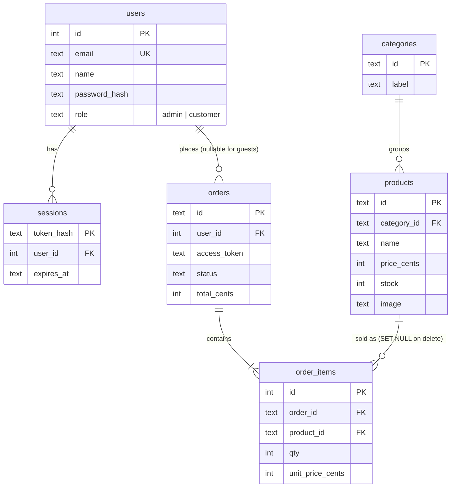

# Database diagram

Source of truth: `database/schema.sql`. SQLite, foreign keys on, money in integer cents.

Delete rules: deleting a user removes their sessions and leaves their orders as guest orders; deleting an order removes its lines; deleting a product keeps order lines (name and price are copied at purchase time); a category cannot be deleted while products use it. Every foreign key column has an index.
